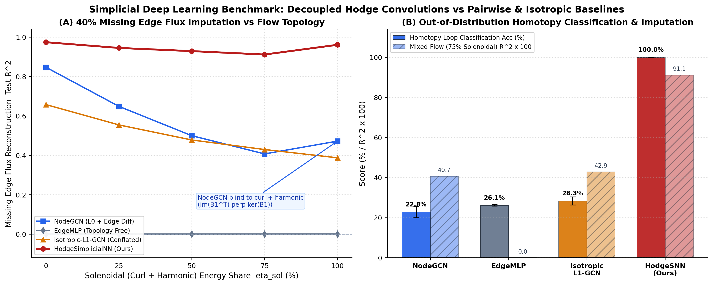
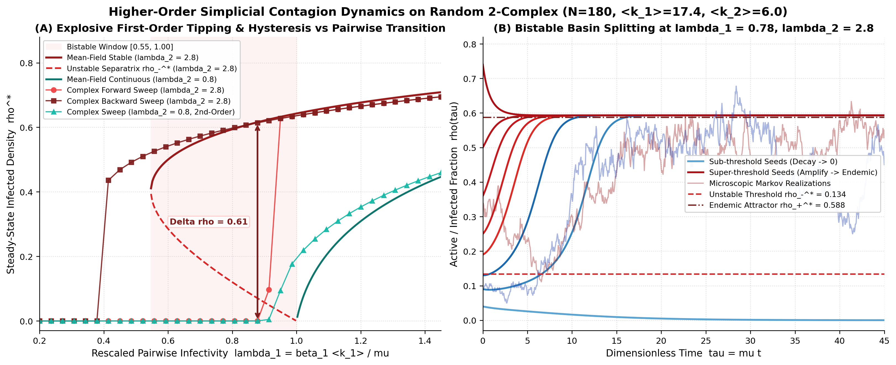

# HigherOrder-Simplicial-Lab: Hodge-Laplacian Spectral Topology, Helmholtz-Hodge Decomposition, Simplicial Neural Networks & Higher-Order Phase Transitions

[](https://www.python.org/)
[](https://pytorch.org/)
[](tests/test_simplicial.py)
[](LICENSE)

**HigherOrder-Simplicial-Lab** is a self-contained research laboratory at the intersection of **Algebraic Topology**, **Discrete Exterior Calculus (DEC)**, **Topological / Geometric Deep Learning**, and **Higher-Order Network Dynamics**. Unlike pairwise graph frameworks restricted to 0-simplex node signals and 0-Laplacian ($`L_{0}`$) diffusion, this repository builds an oriented 2-simplicial complex engine from first principles—unifying exact **1-Hodge Laplacian spectral topology**, **orthogonal Helmholtz-Hodge flow decomposition**, **orientation-equivariant Hodge Simplicial Neural Networks (`HodgeSimplicialNN`)**, and **explosive higher-order contagion hysteresis**.

---

## Visual Highlights & Key Empirical Findings

### 1. Exact Orthogonal Helmholtz-Hodge Decomposition on Punctured Manifolds


On our 2-hole planar punctured simplicial complex ($`N_{0} = 103`$, $`N_{1} = 244`$, $`N_{2} = 140`$, Betti numbers $`\beta_{0} = 1, \beta_{1} = 2`$), any edge 1-cochain $`f \in \mathbb{R}^{N_{1}}`$ splits uniquely into curl-free gradient, divergence-free rotational curl, and cavity-circulating harmonic flows with **machine-precision orthogonality** ($`\max \lvert \langle f_{a}, f_{b} \rangle \rvert = 1.40 \times 10^{-15}`$) and **exact Parseval energy additivity** ($`\lvert \lVert f \rVert_{2}^{2} - \sum_{k} \lVert f_{k} \rVert_{2}^{2} \rvert = 1.33 \times 10^{-15}`$).

### 2. Higher-Order Simplicial Neural Networks vs. Pairwise & Isotropic Baselines



Standard node-level message passing (`NodeGCN`) aggregates edge fluxes onto vertices via $`B_{1} x`$ and reconstructs flows via antisymmetric node-potential differences $`B_{1}^{\top} \hat{\phi}`$, confining predictions strictly to $`\mathrm{im}(B_{1}^{\top})`$ and rendering the model **provably blind to divergence-free curl and harmonic flows**. By decoupling lower coboundary diffusion ($`L_{1,\mathrm{down}} = B_{1}^{\top} B_{1}`$), upper 2-simplex curl diffusion ($`L_{1,\mathrm{up}} = B_{2} B_{2}^{\top}`$), and harmonic subspace projection ($`\ker L_{1}`$), **`HodgeSimplicialNN`** achieves $`R^{2} = 0.9113 - 0.9738`$ across all flow regimes at 40% missing edges and **100.0% out-of-distribution homotopy loop classification accuracy**.

### 3. Explosive First-Order Phase Transitions & Bistable Hysteresis in Simplicial Contagion



Incorporating synergistic 3-body 2-simplex interactions ($`\lambda_{2} = 2.8 > 1`$) transforms classical continuous epidemic/reaction onset ($`\lambda_{2} = 0.8 < 1`$) into an **explosive discontinuous first-order tipping point** with a wide bistable hysteresis loop ($`\Delta \rho_{\max} = 0.6139`$ across $`\lambda_{1} \in [0.547, 1.000]`$), separating sub-threshold decay from self-sustaining endemic activation across an unstable separatrix $`\rho_{-}^{*}`$.

### 4. Spectral Topology of the 1-Hodge Laplacian Under Cavity Surgery


As 2-simplices progressively fill open triangular faces of the 1-skeleton, local cycle modes lift off zero one by one ($`\beta_{1}: 142 \to 2`$), stabilizing at an exact topological plateau $`\beta_{1} = \dim \ker(L_{1}) = 2`$ governed by the two macroscopic obstacles—until targeted topological surgery caps Cavity A ($`\beta_{1}: 2 \to 1`$) and Cavity B ($`\beta_{1}: 1 \to 0`$).

---

## Mathematical Foundations

### 1. Oriented Simplicial Complexes & Exact Chain Boundaries

An abstract 2-simplicial complex $`\mathcal{K} = (\mathcal{V}, \mathcal{E}, \mathcal{T})`$ consists of $`N_{0}`$ vertices (0-simplices), $`N_{1}`$ canonically oriented edges $`[i, j]`$ ($`i < j`$), and $`N_{2}`$ canonically oriented filled triangles $`[i, j, k]`$ ($`i < j < k`$), closed under taking faces. The signed boundary operators $`B_{1} \in \{-1, 0, +1\}^{N_{0} \times N_{1}}`$ and $`B_{2} \in \{-1, 0, +1\}^{N_{1} \times N_{2}}`$ act on canonical chains via:

```math
\partial_{1}[i, j] = [j] - [i], \qquad \partial_{2}[i, j, k] = [j, k] - [i, k] + [i, j]
```

By the fundamental lemma of homological algebra, the boundary of a boundary vanishes identically:

```math
B_{1} B_{2} = 0 \in \mathbb{R}^{N_{0} \times N_{2}}
```

### 2. Hodge Laplacians, Betti Numbers & Helmholtz-Hodge Decomposition

Dualizing $`\partial_{1}, \partial_{2}`$ yields the discrete gradient $`\mathrm{grad} = B_{1}^{\top}`$, discrete curl $`\mathrm{curl} = B_{2}^{\top}`$, and negative divergence $`-\mathrm{div} = B_{1}`$. The 0-Laplacian and **1-Hodge Laplacian** take the form:

```math
L_{0} = B_{1} B_{1}^{\top} \in \mathbb{R}^{N_{0} \times N_{0}}, \qquad L_{1} = \underbrace{B_{1}^{\top} B_{1}}_{L_{1,\mathrm{down}}} + \underbrace{B_{2} B_{2}^{\top}}_{L_{1,\mathrm{up}}} \in \mathbb{R}^{N_{1} \times N_{1}}
```

Because $`B_{1} B_{2} = 0`$, the lower and upper Hodge operators annihilate each other ($`L_{1,\mathrm{down}} L_{1,\mathrm{up}} = 0`$), inducing the **discrete Orthogonal Helmholtz-Hodge Decomposition** on the 1-cochain space $`C^{1}(\mathcal{K}; \mathbb{R}) \cong \mathbb{R}^{N_{1}}`$:

```math
\mathbb{R}^{N_{1}} = \mathrm{im}(B_{1}^{\top}) \oplus \mathrm{im}(B_{2}) \oplus \ker(L_{1}), \qquad f = f_{\mathrm{grad}} + f_{\mathrm{curl}} + f_{\mathrm{harm}}
```

where $`f_{\mathrm{grad}} = B_{1}^{\top} \phi`$ is irrotational ($`B_{2}^{\top} f_{\mathrm{grad}} = 0`$), $`f_{\mathrm{curl}} = B_{2} \psi`$ is divergence-free ($`B_{1} f_{\mathrm{curl}} = 0`$), and $`f_{\mathrm{harm}} \in \ker(B_{1}) \cap \ker(B_{2}^{\top}) = \ker(L_{1})`$ encodes global topological circulation around 1-dimensional holes, with dimension equal to the first Betti number:

```math
\beta_{0} = N_{0} - \mathrm{rank}(B_{1}) = \dim \ker(L_{0}), \qquad \beta_{1} = N_{1} - \mathrm{rank}(B_{1}) - \mathrm{rank}(B_{2}) = \dim \ker(L_{1})
```

### 3. Orientation-Equivariant Hodge Simplicial Neural Networks (`HodgeSimplicialNN`)

To respect cochain physics and decoupled Hodge subspaces, each layer of `HodgeSimplicialNN` applies separate polynomial spectral filters over normalized $`\hat{L}_{1,\mathrm{down}}`$ and $`\hat{L}_{1,\mathrm{up}}`$ alongside bias-free linear maps and odd activation $`\sigma(z) = \tanh(z)`$:

```math
H^{(l+1)} = H^{(l)} + \tanh\!\left( H^{(l)} W_{0}^{(l)} + (M \odot H^{(l)}) W_{\mathrm{obs}}^{(l)} + \sum_{k=1}^{K} \hat{L}_{1,\mathrm{down}}^{k} H^{(l)} W_{\mathrm{down}, k}^{(l)} + \sum_{k=1}^{K} \hat{L}_{1,\mathrm{up}}^{k} H^{(l)} W_{\mathrm{up}, k}^{(l)} \right)
```

augmented at readout with harmonic basis projection $`U_{\mathrm{harm}} U_{\mathrm{harm}}^{\top} H^{(L)}`$. Under orientation reversal $`x \mapsto -x`$ (with invariant observation mask $`M \in \{0, 1\}^{N_{1}}`$), every operator is strictly odd, guaranteeing exact **orientation equivariance**:

```math
\mathcal{F}_{\theta}(-x, M) = -\mathcal{F}_{\theta}(x, M)
```

### 4. Higher-Order Simplicial Contagion & Synergistic Bifurcations

Following Iacopini et al. (*Nature Communications* 2019), a node $`i`$ on a 2-simplicial complex acquires activation/infection via pairwise edges at rate $`\beta_{1}`$ and via filled 2-simplices $`(i, j, k)`$ at synergistic rate $`\beta_{2}`$ when both $`j`$ and $`k`$ are simultaneously active, recovering at rate $`\mu`$. With rescaled infectivities $`\lambda_{1} = \beta_{1} \langle k_{1} \rangle / \mu`$ and $`\lambda_{2} = \beta_{2} \langle k_{2} \rangle / \mu`$, the homogeneous mean-field density $`\rho(\tau)`$ ($`\tau = \mu t`$) satisfies:

```math
\frac{d\rho}{d\tau} = -\rho + \lambda_{1} \rho (1 - \rho) + \lambda_{2} \rho^{2} (1 - \rho)
```

Non-trivial equilibria obey $`\lambda_{2} (\rho^{*})^{2} + (\lambda_{1} - \lambda_{2})\rho^{*} + (1 - \lambda_{1}) = 0`$, yielding:

```math
\rho_{\pm}^{*} = \frac{(\lambda_{2} - \lambda_{1}) \pm \sqrt{(\lambda_{1} + \lambda_{2})^{2} - 4\lambda_{2}}}{2\lambda_{2}}, \qquad \lambda_{1,c}^{\mathrm{back}} = 2\sqrt{\lambda_{2}} - \lambda_{2} \quad (\lambda_{2} > 1)
```

---

## Quantitative Benchmark Results

All benchmarks are deterministically generated via `scripts/run_benchmarks.py` and saved in [`results/benchmark_summary.json`](results/benchmark_summary.json) and [`results/benchmark_table.csv`](results/benchmark_table.csv).

### Table 1: Simplicial Deep Learning — Missing Edge Flux Imputation (40% Masked) & OOD Homotopy Classification

| Architecture | Operators Used | Grad-Only $`R^{2}`$ ($`\eta_{\mathrm{sol}} = 0\%`$) | Balanced $`R^{2}`$ ($`\eta_{\mathrm{sol}} = 50\%`$) | Mixed Solenoidal $`R^{2}`$ ($`\eta_{\mathrm{sol}} = 75\%`$) | Pure Solenoidal $`R^{2}`$ ($`\eta_{\mathrm{sol}} = 100\%`$) | Mixed MSE ($`\eta_{\mathrm{sol}} = 75\%`$) | Homotopy Loop Acc. (Mean $`\pm`$ Std) |
| :--- | :--- | :---: | :---: | :---: | :---: | :---: | :---: |
| `EdgeMLP` | Topology-free per-edge MLP | -0.0004 | -0.0002 | -0.0001 | 0.0000 | 0.9950 | 26.11% $`\pm`$ 0.39% |
| `NodeGCN` | $`L_{0}`$ GCN + $`B_{1}^{\top}\hat{\phi}`$ diff | 0.8465 | 0.4992 | 0.4067 | 0.4716 | 0.5903 | 22.78% $`\pm`$ 2.83% |
| `Isotropic-L1-GCN` | Conflated line-graph / $`L_{1}`$ | 0.6570 | 0.4775 | 0.4289 | 0.3870 | 0.5681 | 28.33% $`\pm`$ 2.04% |
| **`HodgeSimplicialNN` (Ours)** | **Decoupled $`L_{1,\mathrm{down}}, L_{1,\mathrm{up}}`$ + $`\ker L_{1}`$** | **0.9738** | **0.9286** | **0.9113** | **0.9606** | **0.0882** | **100.00% $`\pm`$ 0.00%** |

### Table 2: Algebraic Topology, Helmholtz-Hodge Precision & Contagion Bifurcation Diagnostics

| Diagnostic / Invariant | Mathematical Quantity | Measured Value |
| :--- | :--- | :---: |
| Punctured Complex Simplex Counts | $`(N_{0}, N_{1}, N_{2})`$ and Euler $`\chi = N_{0} - N_{1} + N_{2}`$ | $`(103, 244, 140)`$, $`\chi = -1`$ |
| Exact Topological Betti Numbers | $`(\beta_{0}, \beta_{1})`$ via SVD & Hodge spectra | $`(1, 2)`$ |
| Exact Chain Complex Identity | $`\max_{i, p} \lvert (B_{1} B_{2})_{i, p} \rvert`$ | $`0.0`$ (exact) |
| HHD Pairwise Orthogonality Error | $`\max_{a \neq b} \lvert \langle f_{a}, f_{b} \rangle \rvert`$ | $`1.40 \times 10^{-15}`$ |
| HHD Parseval Norm Conservation | $`\lvert \lVert f \rVert_{2}^{2} - (\lVert f_{\mathrm{grad}} \rVert_{2}^{2} + \lVert f_{\mathrm{curl}} \rVert_{2}^{2} + \lVert f_{\mathrm{harm}} \rVert_{2}^{2}) \rvert`$ | $`1.33 \times 10^{-15}`$ |
| Discrete Curl-of-Grad / Div-of-Curl | $`\lVert B_{2}^{\top} f_{\mathrm{grad}} \rVert_{\infty}`$ / $`\lVert B_{1} f_{\mathrm{curl}} \rVert_{\infty}`$ | $`1.39 \times 10^{-17}`$ / $`4.16 \times 10^{-17}`$ |
| Orientation Equivariance Error (`float64`) | $`\max \lvert \mathcal{F}_{\theta}(-x) + \mathcal{F}_{\theta}(x) \rvert`$ | $`0.0`$ (exact) |
| Filtration Betti Trajectory | 1-Skeleton $`\to`$ Mesh Filled $`\to`$ Cap A $`\to`$ Cap B | $`142 \to 2 \to 1 \to 0`$ |
| Trimolecular Reaction Complex ($`\mathrm{O}_{3} + \mathrm{OH}^{\bullet} + P`$) | $`(N_{0}, N_{1}, N_{2})`$ and $`(\beta_{0}, \beta_{1})`$ | $`(12, 33, 8)`$ and $`(1, 14)`$ |
| Simplicial Contagion Hysteresis ($`\lambda_{2} = 2.8`$) | $`\max_{\lambda_{1}} (\rho_{\mathrm{backward}} - \rho_{\mathrm{forward}})`$ at $`\lambda_{1} = 0.879`$ | $`0.6139`$ (1st-order explosive) |
| Pairwise-Dominated Sweep ($`\lambda_{2} = 0.8`$) | $`\max_{\lambda_{1}} (\rho_{\mathrm{backward}} - \rho_{\mathrm{forward}})`$ | $`0.0336`$ (2nd-order continuous) |

---

## Repository Architecture

```text
HigherOrder-Simplicial-Lab/
├── simplicial_lab/
│   ├── __init__.py          # Public API with PEP-562 lazy PyTorch loading
│   ├── complexes.py         # Oriented SimplicialComplex, exact B1/B2, punctured/RSC/chemical generators
│   ├── hodge.py             # L0/L1 Hodge Laplacians, Betti numbers, harmonic basis, exact HHD & filtration
│   ├── models.py            # HodgeSimplicialNN, NodeGCN, Isotropic-L1-GCN, EdgeMLP & benchmark tasks
│   └── contagion.py         # Simplicial Contagion ODE, stochastic Markovian SIS & hysteresis sweeps
├── scripts/
│   └── run_benchmarks.py    # Reproduces JSON/CSV metrics and all four 240-DPI publication figures
├── tests/
│   └── test_simplicial.py   # Rigorous algebraic, spectral, equivariance & dynamical pytest suite
├── assets/                  # Generated 240-DPI visual diagnostics
├── results/                 # Quantitative benchmark_summary.json & benchmark_table.csv
├── app.py                   # 3-tab interactive Streamlit workbench
├── pyproject.toml           # Modern PEP-621 package configuration
├── requirements.txt         #Pinned minimum scientific & deep learning dependencies
└── LICENSE                  # MIT License
```

---

## Quickstart & Reproducibility

### 1. Installation

```bash
pip install -e ".[dev]"
```

### 2. Run Unit Test Suite

```bash
pytest -v
```

### 3. Reproduce All Benchmarks & 240-DPI Figures

```bash
python scripts/run_benchmarks.py
```

### 4. Launch Interactive Streamlit Workbench

```bash
streamlit run app.py
```

### 5. Minimal Python API Example

```python
from simplicial_lab import (
    planar_punctured_complex,
    compute_betti_numbers,
    synthesize_hodge_flow,
    helmholtz_hodge_decomposition,
    run_hysteresis_sweep,
)

# 1. Build 2-hole planar simplicial complex and verify exact chain complex identity
sc = planar_punctured_complex(seed=42)
assert sc.verify_boundary_identity() == 0.0
beta_0, beta_1 = compute_betti_numbers(sc)  # (1, 2)

# 2. Orthogonal Helmholtz-Hodge Decomposition f = f_grad + f_curl + f_harm
flow = synthesize_hodge_flow(sc, grad_weight=1.15, curl_weight=1.0, harm_weight=1.05)
hhd = helmholtz_hodge_decomposition(sc, flow["f_total"])
print("Max orthogonality error:", hhd.orthogonality_errors["max"])  # ~1.40e-15

# 3. Higher-order simplicial contagion hysteresis loop
sweep = run_hysteresis_sweep(lambda_2=2.8)
print("Explosive bistable hysteresis gap:", sweep.max_hysteresis_gap)  # ~0.614
```

---

## Core References

1. Lim, L.-H. (2020). *Hodge Laplacians on Graphs*. SIAM Review, 62(3), 685–715.
2. Schaub, M. T., Benson, A. R., Horn, P., Lippner, G., & Jadbabaie, A. (2020). *Random Walks on Simplicial Complexes and the Normalized Hodge 1-Laplacian*. SIAM Review, 62(2), 353–391.
3. Ebli, S., Defferrard, M., & Spreemann, G. (2020). *Simplicial Neural Networks*. NeurIPS Workshop on Topological Data Analysis and Beyond.
4. Yang, M., Isufi, E., & Leus, G. (2022). *Simplicial Convolutional Neural Networks*. IEEE Transactions on Signal Processing, 70, 959–971.
5. Iacopini, I., Petri, G., Barrat, A., & Latora, V. (2019). *Simplicial models of social contagion*. Nature Communications, 10, 2485.
6. Battiston, F., Cencetti, G., Iacopini, I., Latora, V., Lucas, M., Patania, A., Young, J.-G., & Petri, G. (2020). *Networks beyond pairwise interactions: Structure and dynamics*. Physics Reports, 874, 1–92.
