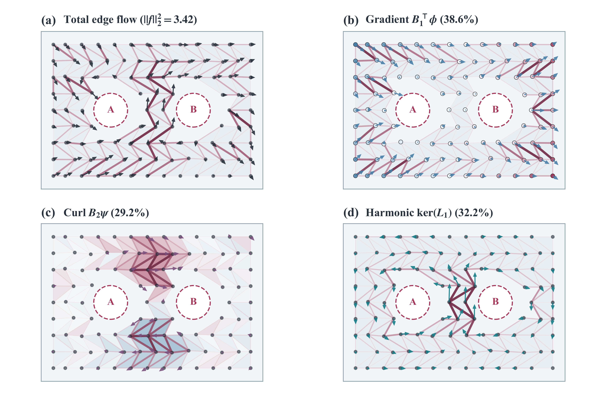
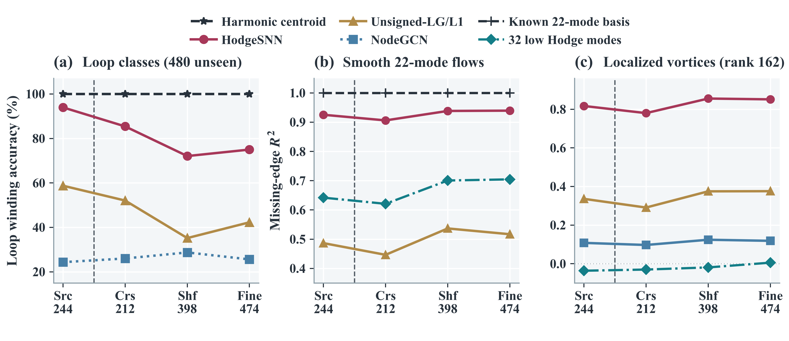
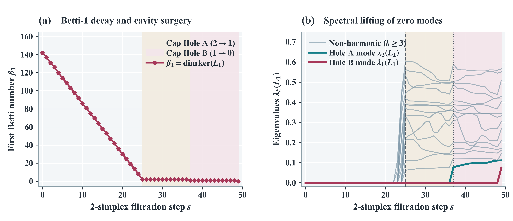

# HigherOrder-Simplicial-Lab

Edge flows on triangulated surfaces and higher-order networks decompose orthogonally into irrotational gradients, divergence-free curls, and cavity-circulating harmonic modes. Whether a Hodge convolutional network outperforms simpler linear or graph-based estimators depends on which of those subspaces carries the target signal and whether the generating subspace is low-dimensional or spatially localized. This repository evaluates discrete Helmholtz–Hodge operators, orientation-equivariant simplicial message passing, matched tied-$`L_1`$ controls, and 2-simplex contagion dynamics across planar punctured meshes.

## 1. Discrete Hodge operators and orientation-equivariant filters

For an oriented 2-simplicial complex $`\mathcal{K} = (\mathcal{V}, \mathcal{E}, \mathcal{T})`$ with signed boundary matrices $`B_1 \in \{-1, 0, +1\}^{N_0 \times N_1}`$ and $`B_2 \in \{-1, 0, +1\}^{N_1 \times N_2}`$, the chain identity $`B_1 B_2 = 0`$ implies $`L_{1,\mathrm{down}} L_{1,\mathrm{up}} = 0`$ for

```math
L_0 = B_1 B_1^\top, \qquad L_1 = \underbrace{B_1^\top B_1}_{L_{1,\mathrm{down}}} + \underbrace{B_2 B_2^\top}_{L_{1,\mathrm{up}}}, \qquad \mathbb{R}^{N_1} = \mathrm{im}(B_1^\top) \oplus \mathrm{im}(B_2) \oplus \ker(L_1).
```

On the reference two-hole complex ($`N_0 = 103`$, $`N_1 = 244`$, $`N_2 = 140`$, $`\beta_0 = 1`$, $`\beta_1 = 2`$; `simplicial_lab/hodge.py`), decomposing $`f = f_{\mathrm{grad}} + f_{\mathrm{curl}} + f_{\mathrm{harm}}`$ yields maximum pairwise inner-product error $`5.33 \times 10^{-16}`$, Parseval residual $`0.0`$, $`\lVert B_2^\top f_{\mathrm{grad}} \rVert_\infty = 1.39 \times 10^{-17}`$, and $`\lVert B_1 f_{\mathrm{curl}} \rVert_\infty = 5.55 \times 10^{-17}`$ (`results/benchmark_summary.json`).



Each layer of `HodgeSimplicialNN` (`simplicial_lab/models.py`) applies separate bias-free polynomial filters to normalized $`\hat{L}_{1,\mathrm{down}}`$ and $`\hat{L}_{1,\mathrm{up}}`$ with odd $`\tanh`$ activations and a harmonic readout $`U_{\mathrm{harm}} U_{\mathrm{harm}}^\top`$:

```math
H^{(l+1)} = H^{(l)} + \tanh\!\left( H^{(l)} W_0^{(l)} + (M \odot H^{(l)}) W_{\mathrm{obs}}^{(l)} + \sum_{k=1}^K \hat{L}_{1,\mathrm{down}}^k H^{(l)} W_{\mathrm{down},k}^{(l)} + \sum_{k=1}^K \hat{L}_{1,\mathrm{up}}^k H^{(l)} W_{\mathrm{up},k}^{(l)} \right).
```

Under any diagonal edge-orientation gauge $`D = \mathrm{diag}(\pm 1)`$ transforming $`(x, B_1, B_2) \mapsto (Dx, B_1 D, D B_2)`$, the edge prediction transforms covariantly as $`D \hat{y}`$ (maximum discrepancy $`6.11 \times 10^{-16}`$ in `float64` and $`0.0`$ in `float32`).

---

## 2. Three empirical regimes: where analytical and linear baselines win versus where decoupled Hodge filtering helps

### 2.1 Homology loop classification across unseen meshes (`Harmonic Centroid` > `HodgeSimplicialNN`)

Training on a $`13 \times 9`$ two-hole source mesh (`244` edges, three seeds `42`, `101`, `202`) and evaluating frozen weights on three unseen two-hole meshes (`coarse` `212` edges, `shifted` `398` edges, `fine` `474` edges; `160` fresh test loops per mesh = `480` held-out loops, `scripts/evaluate_mesh_transfer.py`) separates global homology from learned message passing:

| Method | Source (`244` edges) | Coarse (`212` edges) | Shifted (`398` edges) | Fine (`474` edges) | Held-out mean (`480` loops) |
| --- | ---: | ---: | ---: | ---: | ---: |
| `Harmonic Centroid` (2 coordinates) | 100.0% | 100.0% | 100.0% | 100.0% | 100.0% (480/480) |
| `HodgeSimplicialNN` | 93.96% | 85.42% | 72.08% | 75.00% | 77.50% |
| `EdgeLineGraphGCN` (unsigned LG / $`L_1`$) | 58.75% | 52.08% | 35.21% | 42.29% | 43.19% |
| `EdgeMLP` (cavity pooling only) | 54.38% | 46.67% | 34.38% | 36.46% | 39.17% |
| `NodeGCN` ($`L_0`$ gradient difference) | 24.38% | 26.04% | 28.75% | 25.62% | 26.81% |

When ordered hole correspondence is known across meshes, projecting noisy edge trajectories onto the two-dimensional harmonic basis $`\ker(L_1)`$ eliminates simulated gradient and curl perturbations directly and classifies all **480/480** held-out loops (`+22.50` percentage points over `HodgeSimplicialNN`, 95% paired bootstrap CI `19.44–25.63`, exact McNemar Holm-adjusted $`p \lt 10^{-30}`$).

### 2.2 Low-mode synthetic flows versus full-rank localized vortices (`40%` missing edges)

In the original same-mesh benchmark (`results/linear_imputation_control.json`), synthetic flows lie in a 10-to-22-mode subspace. Fitting an empirical SVD basis to the 150 complete training flows recovers missing entries with $`R^2 = 0.99983\text{--}0.99993`$, exceeding `HodgeSimplicialNN` (`0.9309–0.9767`). Across meshes of unequal edge counts (`212`, `398`, `474`) where a fixed-dimension source SVD cannot transfer, behavior splits between smooth low-mode flows and full-rank localized vortices (`effective rank 160–164` with odd saturation $`\tanh(1.35 f) + 0.45 f`$):

| Flow regime & method | Source (`244`) | Coarse (`212`) | Shifted (`398`) | Fine (`474`) |
| --- | ---: | ---: | ---: | ---: |
| Smooth 22-mode $`R^2`$ · Known 22-mode basis | 0.9998 | 0.9998 | 0.9999 | 0.9999 |
| Smooth 22-mode $`R^2`$ · `HodgeSimplicialNN` | 0.9256 | 0.9063 | 0.9386 | 0.9397 |
| Smooth 22-mode $`R^2`$ · 32 target low Hodge modes | 0.6420 | 0.6209 | 0.7007 | 0.7046 |
| Localized vortex $`R^2`$ · `HodgeSimplicialNN` | 0.8171 | 0.7801 | 0.8556 | 0.8514 |
| Localized vortex $`R^2`$ · `EdgeLineGraphGCN` | 0.3361 | 0.2910 | 0.3750 | 0.3758 |
| Localized vortex $`R^2`$ · `NodeGCN` ($`\mathrm{im}(B_1^\top)`$) | 0.1080 | 0.0971 | 0.1242 | 0.1185 |
| Localized vortex $`R^2`$ · 32 target low Hodge modes | -0.0363 | -0.0302 | -0.0192 | 0.0055 |

On localized eddies, global low-Hodge spectral completion collapses ($`R^2 \in [-0.036, 0.006]`$), and frozen `HodgeSimplicialNN` reduces per-signal missing-edge MSE across the 180 held-out test signals by `0.481` (`95%` CI `0.464–0.499`, Holm-adjusted $`p \lt 10^{-30}`$) relative to `EdgeLineGraphGCN` and by `0.843` (`95%` CI `0.820–0.867`, Holm-adjusted $`p \lt 10^{-30}`$) relative to 32-mode spectral completion.



### 2.3 Architecture-matched `Tied-L1` control (`scripts/evaluate_anisotropic_control.py`)

Because `EdgeLineGraphGCN` mixes `75%` unsigned line-graph adjacency with `25%` $`L_1`$ and omits mask gating and harmonic skip paths, `scripts/evaluate_anisotropic_control.py` evaluates a strictly architecture- and parameter-matched orientation-equivariant `TiedL1SimplicialNN` (`27,320` parameters vs. `25,696` for `HodgeSimplicialNN`) across 10 paired random seeds on the source (`244` edges) and unseen shifted (`398` edges) meshes (`results/anisotropic_constitutive_control.json`):

| Task (`10` paired seeds) | `HodgeSimplicialNN` (`25.7k`) | `TiedL1SimplicialNN` (`27.3k`) | `Unsigned-LG GCN` (`18.5k`) | `Hodge` minus `Tied-L1` (95% CI) | Holm *p* |
| --- | ---: | ---: | ---: | ---: | ---: |
| Localized imputation, source (`244`) | 0.7098 ± 0.016 | 0.2718 ± 0.021 | 0.1795 ± 0.023 | +0.438 [+0.427, +0.450] | 0.0117 |
| Localized imputation, unseen (`398`) | 0.7484 ± 0.009 | 0.2851 ± 0.011 | 0.1735 ± 0.024 | +0.463 [+0.459, +0.467] | 0.0117 |
| Opposing grad/curl operator, source (`244`) | 0.8509 ± 0.015 | 0.4538 ± 0.022 | 0.2982 ± 0.031 | +0.397 [+0.385, +0.408] | 0.0117 |
| Opposing grad/curl operator, unseen (`398`) | 0.8670 ± 0.010 | 0.4999 ± 0.016 | 0.3161 ± 0.028 | +0.367 [+0.358, +0.377] | 0.0117 |

Restoring gauge-equivariant signed $`L_1`$, mask gating, and harmonic projection raises unseen-mesh $`R^2`$ from `0.1735` (`Unsigned-LG GCN`) to `0.2851` (`TiedL1SimplicialNN`, `+0.112`, Holm-adjusted $`p = 0.0117`$). Nevertheless, decoupling $`\hat{L}_{1,\mathrm{down}}`$ from $`\hat{L}_{1,\mathrm{up}}`$ adds a further `+0.463` on localized missing-edge imputation and `+0.367` under opposing gradient/curl conductivities ($`+1.15 f_{\mathrm{grad}} - 0.95 f_{\mathrm{curl}}`$), because binary edge masking introduces artificial vertex divergence and triangle curl that cannot be filtered independently by any single polynomial $`p(L_1)`$.


---

## 3. Simplicial contagion bistability and Hodge spectral filtration

On a 180-node random 2-simplicial complex ($`\langle k_1 \rangle = 17.4`$, $`\langle k_2 \rangle = 6.0`$; Iacopini et al., 2019), pairwise-dominated contagion ($`\lambda_2 = 0.8 \lt 1`$) exhibits a continuous onset at $`\lambda_1 = 1`$, whereas strong 2-simplex synergy ($`\lambda_2 = 2.8 \gt 1`$) creates a saddle-node bifurcation at $`\lambda_{1,c}^{\mathrm{back}} = 2\sqrt{\lambda_2} - \lambda_2 = 0.547`$ with hysteresis width $`\Delta\rho_{\max} = 0.614`$. Under progressive 2-simplex filtration of the punctured complex, $`\beta_1 = \dim\ker(L_1)`$ drops from `142` (1-skeleton cycles) to an exact plateau at `2` once non-cavity faces are filled, and steps `2 -> 1 -> 0` only when Holes A and B are capped.




---

## 4. Reproducibility

```bash
pip install -e ".[dev]"
pytest -q

# Re-run same-mesh benchmarks, cross-mesh transfer, and 10-seed matched Tied-L1 controls
python scripts/run_benchmarks.py
python scripts/evaluate_mesh_transfer.py
python scripts/evaluate_anisotropic_control.py

# Regenerate all five 600-DPI figures with programmatic QA checks
python scripts/generate_figures.py
```

## References

1. Holm, S. (1979). A simple sequentially rejective multiple test procedure. *Scandinavian Journal of Statistics*, 6(2), 65–70.
2. Iacopini, I., Petri, G., Barrat, A., & Latora, V. (2019). Simplicial models of social contagion. *Nature Communications*, 10, 2485.
3. Lim, L.-H. (2020). Hodge Laplacians on graphs. *SIAM Review*, 62(3), 685–715.
4. Schaub, M. T., Benson, A. R., Horn, P., Lippner, G., & Jadbabaie, A. (2020). Random walks on simplicial complexes and the normalized Hodge 1-Laplacian. *SIAM Review*, 62(2), 353–391.

## License

MIT License (`LICENSE`).
